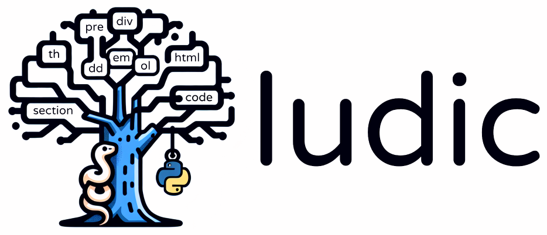
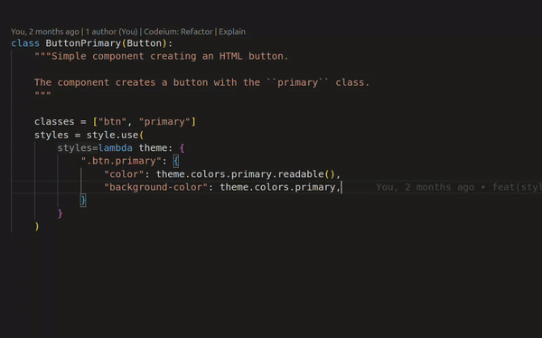

<p align="center">
    
</p>

[](https://github.com/getludic/ludic/actions) [](https://codecov.io/gh/getludic/ludic) [](https://www.python.org/downloads/) [](http://mypy-lang.org/) [](https://discord.gg/7nK4zAXAYC)

**Documentation**: https://getludic.dev/docs/

---

Ludic lets you write HTML as typed Python components. Your type checker validates the markup, so wrong nesting, unknown attributes and missing arguments are caught before a page ever renders. At its core Ludic only renders HTML, so it fits into the web framework you already use, and it pairs naturally with [htmx](https://htmx.org/).

```python
from typing import override

from ludic import Attrs, Component
from ludic.html import a, b, p


class LinkAttrs(Attrs):
    to: str


class Link(Component[str, LinkAttrs]):
    @override
    def render(self) -> a:
        return a(*self.children, href=self.attrs["to"])


p(t"Hello {b('Stranger')}! Click {Link('here', to='/home')}.").to_html()
# <p>Hello <b>Stranger</b>! Click <a href="/home">here</a>.</p>
```

Invalid markup is a type error. This is what [mypy](https://mypy-lang.org/) reports:

```python
br("Hello, World!")
# error: Argument 1 to "br" has incompatible type "str"; expected "Never"

html(body())
# error: Argument 1 to "html" has incompatible type "body"; expected "head"

div("Test", href="test")
# error: Unexpected keyword argument "href" for "div"

Link("here", too="/home")
# error: Unexpected keyword argument "too" for "Link"; did you mean "to"?

Link(div("here"), to="/home")
# error: Argument 1 to "Link" has incompatible type "div"; expected "str"

Link("here")
# error: Missing named argument "to" for "Link"
```

---

*"I've just composed my first `PageLayout` component and I have no words!"*

– Igor Davydenko

---

## Features

- **Type-guided HTML**: every element knows which children and attributes it allows
- **Components** in pure Python, composed like in [React](https://react.dev/)
- Mix markup and text with Python 3.14 **t-strings** (template strings)
- Text is **escaped by default**, trusted markup is marked explicitly with `Safe`
- Typed **&lt;/&gt; htmx** attributes, so dynamic pages need almost no JavaScript
- Works with **Starlette**, **FastAPI** and **Django**, or with no framework at all
- Typed CSS for your components with **Themes**
- Simple, responsive layouts adopted from the **Every Layout Book**

## Installation

Ludic 1.x requires Python 3.14+ for t-string support. If you are on Python 3.12 or 3.13, use Ludic 0.5.x, which uses f-strings instead.

The core package renders HTML and has a single dependency:

```
pip install ludic
```

To also get the Starlette based web framework, form parsing and code highlighting:

```
pip install "ludic[full]"
```

You can also use a basic cookiecutter template to get started quickly. With [UV](https://docs.astral.sh/uv/), you need to run only one command:

```
uvx cookiecutter gh:getludic/template
```

### Type Checking

Elements from `ludic.html` are checked by plain type hints, so mypy and pyright (and Pylance in VS Code) report the errors above, except those about component attributes. To also check the attributes of your own components, enable the mypy plugin in `pyproject.toml`:

```toml
[tool.mypy]
plugins = ["ludic.mypy_plugin"]
```

mypy supports t-strings since version 2.0. Older versions report every t-string as an error.

## Use It With Your Framework

Ludic does not enforce any frontend or backend framework. Pick the integration that matches your stack:

**[Starlette](https://getludic.dev/docs/web-framework)** – `LudicApp` is a thin wrapper around Starlette, handlers return elements directly:

```python
from ludic.html import b, p
from ludic.web import LudicApp

app = LudicApp()


@app.get("/")
async def homepage() -> p:
    return p(t"Hello {b('Stranger')}!")
```

**[FastAPI](https://getludic.dev/docs/integrations#fastapi)** – set the route class and return elements from your endpoints:

```python
from fastapi import FastAPI

from ludic.contrib.fastapi import LudicRoute
from ludic.html import p

app = FastAPI()
app.router.route_class = LudicRoute


@app.get("/")
async def homepage() -> p:
    return p("Hello, World!")
```

**[Django](https://getludic.dev/docs/integrations#django)** – wrap the element in a response:

```python
from django.http import HttpRequest

from ludic.contrib.django import LudicResponse
from ludic.html import p


def index(request: HttpRequest) -> LudicResponse:
    return LudicResponse(p("Hello, World!"))
```

**Anything else** – `element.to_html()` returns a string, which every framework can send as a response.

## htmx

htmx attributes are typed like any other attribute:

```python
button("Load more", hx_get="/items?page=2", hx_target="#items", hx_swap="beforeend")
# <button hx-get="/items?page=2" hx-target="#items" hx-swap="beforeend">Load more</button>
```

The [examples](https://getludic.dev/examples) reimplement the patterns from htmx.org, such as click to edit, infinite scroll, active search and bulk update.

## Composable Components

Instead of using only basic HTML elements, you can build modular components with the support of Python's type system. The [catalog](https://getludic.dev/catalog/) ships ready-made ones:

```python
Table(
    TableHead("Id", "Name"),
    TableRow("1", "John"),
    TableRow("2", "Jane"),
    TableRow("3", "Bob"),
)
```

This structure is type-checked: a `Table` expects one `TableHead` followed by any number of `TableRow` components.

## Styles and Themes

Components can declare their CSS classes and styles, and read colors, fonts and sizes from the active theme:

```python
class Link(Component[str, LinkAttrs]):
    classes = ["link"]

    @override
    def render(self) -> a:
        return a(
            *self.children,
            href=self.attrs["to"],
            style={"color": self.theme.colors.primary},
        )
```

CSS properties are typed as well, so your editor completes them:

<p align="center">
    
</p>

## Comparison

Here is how Ludic compares to other ways of producing HTML in Python:

| | Ludic | [htpy](https://htpy.dev/) | [FastHTML](https://fastht.ml/) | [tdom](https://github.com/t-strings/tdom) | [Jinja2](https://jinja.palletsprojects.com/) |
|---|---|---|---|---|---|
| How you write HTML | Python calls and t-strings | Python calls, children in `[]` | Python calls | HTML inside t-strings | Template files |
| Children and attributes type-checked per element | Yes | No | No | No | No |
| Web framework | Optional: Starlette, FastAPI, Django or none | Any | Its own, built on Starlette | Any | Any |
| Python | 3.14+ (3.12+ with 0.5.x) | 3.10+ | 3.10+ | 3.14+ | 3.7+ |

The others are a better fit in some cases:

- **htpy** supports older Python versions and needs no type checker plugin.
- **FastHTML** is a complete web framework rather than a library you add to one.
- **tdom** lets you write real HTML syntax instead of Python calls.
- **Jinja2** keeps templates in files that people who do not write Python can edit.

## Migration from v0.5 to v1.0

Ludic 1.0 requires Python 3.14+ and introduces a major change: **t-strings (template strings)** replace the previous f-string approach with `FormatContext`. This provides better performance, simpler code, and enhanced security.

### Key Changes

**Replace `f"` with `t"`** when mixing HTML elements with text:

```python
# v0.5 (f-strings)
div(f"Hello {b('World')}")

# v1.0 (t-strings)
div(t"Hello {b('World')}")
```

### Version Compatibility

- **Ludic 0.5.x**: Python 3.12, 3.13 (uses f-strings)
- **Ludic 1.0.x**: Python 3.14+ (uses t-strings)

## More Examples

For more complex usage incorporating all capabilities of the framework:

- visit the examples on [getludic.dev](https://getludic.dev/examples)
- check the folder with examples [on GitHub](https://github.com/getludic/ludic/tree/main/examples/)
- check the source code of the [Ludic Catalog](https://github.com/getludic/ludic/tree/main/ludic/catalog)
- inspect the [source of getludic.dev](https://github.com/getludic/web/blob/main/web/endpoints/docs/htmx.py) which is written with Ludic
- check [this small repository](https://github.com/getludic/ludic-slides/blob/main/ludic_slides/components.py) rendering slides in the browser

## Agent Skills

Ludic ships two agent skills, installable via the [`skills`](https://www.npmjs.com/package/skills) CLI (works with any supported coding agent):

- [`ludic-components`](skills/ludic-components/SKILL.md) — building components: t-string templating, `Component` / `ComponentStrict` typing, the catalog widgets, htmx attributes, the trusted-vs-untrusted (`Safe`) content boundary.
- [`ludic-web`](skills/ludic-web/SKILL.md) — building web apps: `LudicApp`, typed `Endpoint` classes, FastAPI / Django integrations, parsers and responses, htmx response patterns, and **safe URL generation (host header poisoning mitigations)**.

Install one:

```bash
npx skills add https://github.com/getludic/ludic --skill ludic-components
npx skills add https://github.com/getludic/ludic --skill ludic-web
```

Install both at once:

```bash
npx skills add https://github.com/getludic/ludic --skill ludic-components --skill ludic-web
# or, equivalently:
npx skills add https://github.com/getludic/ludic --skill '*'
```

In Claude Code, you can install both skills as a plugin instead:

```
/plugin marketplace add getludic/ludic
/plugin install ludic@ludic
```

Once installed, the agent will pick the relevant skill up automatically whenever you ask it to write or modify Ludic code.

Agents that look up documentation with [Context7](https://context7.com/getludic/ludic) get the Ludic docs and a short list of rules for writing Ludic code from there.

## Contributing

Any contributions to the framework are warmly welcome! Your help will make it a better resource for the community. If you're ready to contribute, read the [contribution guide](https://github.com/getludic/ludic/tree/main/CONTRIBUTING.md).

* [GitHub Issues](https://github.com/getludic/ludic/issues) - If you encounter a bug, please report it here.
* [GitHub Discussions](https://github.com/getludic/ludic/discussions) - To request a new feature, this is the best place to initiate the discussion.
* [Discord](https://discord.gg/7nK4zAXAYC) - Join our Discord server for support, sharing ideas, and receiving assistance.
